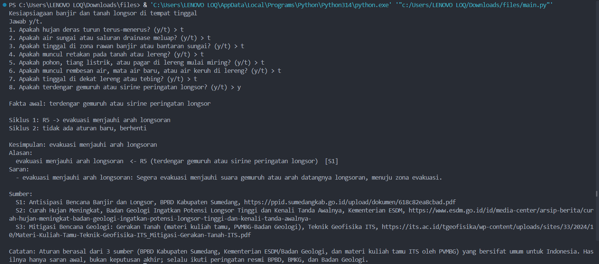
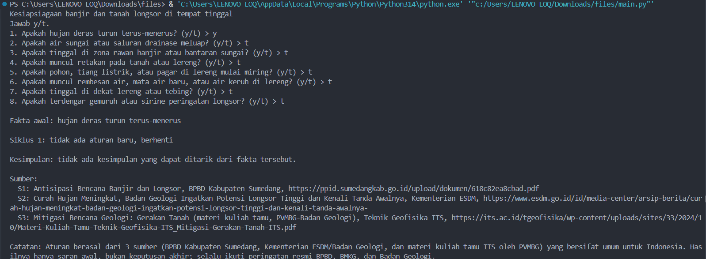
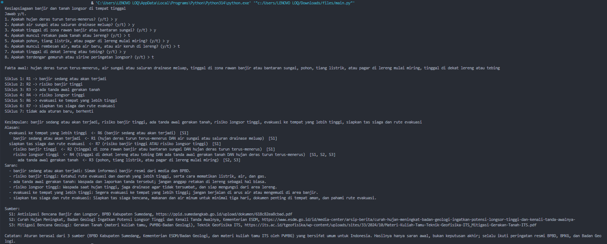

# Tugas 5 Kecerdasan Buatan: Sistem Pakar Sederhana

## 1. Identitas
- Nama: **Moh. Saqif Dendi Al Fayyed**
- NIM: **F1D02410122**

## 2. Topik dan cara menjalankan
**Topik:** kesiapsiagaan banjir dan tanah longsor di tempat tinggal.

- Bahasa: Python 3 (versi 3.8 ke atas), tanpa library tambahan.
- Jalankan: `python main.py` (di folder yang sama dengan `aturan.py`).
- Jawab pertanyaan dengan `y` (ya) atau `t` (tidak).

## 3. Sumber dan tabel aturan

### Sumber
| Kode | Judul | Penerbit | URL | Tanggal akses |
|---|---|---|---|---|
| S1 | Antisipasi Bencana Banjir dan Longsor | BPBD Kabupaten Sumedang (tahun terbit tidak tertera) | https://ppid.sumedangkab.go.id/upload/dokumen/618c82ea8cbad.pdf | 12 November 2026 |
| S2 | Curah Hujan Meningkat, Badan Geologi Ingatkan Potensi Longsor Tinggi dan Kenali Tanda Awalnya (26 Februari 2018) | Kementerian ESDM | https://www.esdm.go.id/id/media-center/arsip-berita/curah-hujan-meningkat-badan-geologi-ingatkan-potensi-longsor-tinggi-dan-kenali-tanda-awalnya- | 12 November 2026 |
| S3 | Mitigasi Bencana Geologi: Gerakan Tanah (materi kuliah tamu oleh penyelidik bumi PVMBG-Badan Geologi) | Teknik Geofisika, Institut Teknologi Sepuluh Nopember (ITS) | https://its.ac.id/tgeofisika/wp-content/uploads/sites/33/2024/10/Materi-Kuliah-Tamu-Teknik-Geofisika-ITS_Mitigasi-Gerakan-Tanah-ITS.pdf | 12 November 2026 |

### Aturan IF-THEN (disimpan di `aturan.py`)
| Aturan | IF | THEN | Sumber |
|---|---|---|---|
| R1 | hujan deras terus-menerus **AND** air sungai/drainase meluap | banjir sedang atau akan terjadi | S1 |
| R2 | tinggal di zona rawan banjir/bantaran sungai **AND** hujan deras terus-menerus | risiko banjir tinggi | S1 |
| R3 | retakan pada tanah/lereng **OR** pohon/tiang/pagar di lereng miring **OR** rembesan air/mata air baru/air keruh di lereng | ada tanda awal gerakan tanah | S2, S3 |
| R4 | tinggal di dekat lereng/tebing **AND** ada tanda awal gerakan tanah **AND** hujan deras terus-menerus | risiko longsor tinggi | S1, S2, S3 |
| R5 | terdengar gemuruh atau sirine peringatan longsor | evakuasi menjauhi arah longsoran | S1 |
| R6 | banjir sedang atau akan terjadi | evakuasi ke tempat yang lebih tinggi | S1 |
| R7 | risiko banjir tinggi **OR** risiko longsor tinggi | siapkan tas siaga dan rute evakuasi | S1 |

Beberapa hasil aturan menjadi syarat aturan lain, sehingga terbentuk rantai inferensi (misalnya R3 → R4 → R7).

## 4. Metode: Forward Chaining (FC)
Dipilih FC karena pengguna biasanya mulai dari kondisi yang ia lihat atau alami (fakta), lalu program mencari kesimpulan apa saja yang bisa ditarik. Cocok untuk kesiapsiagaan bencana yang kesimpulannya bertingkat: tanda awal, tingkat risiko, lalu tindakan.

Cara kerja: fakta jawaban "ya" dimasukkan ke memori. Program mengulang: cari aturan yang syaratnya terpenuhi dan hasilnya belum ada di memori, ambil aturan pertama, tambahkan hasilnya ke memori, catat aturan itu sebagai alasan. Berhenti kalau tidak ada aturan baru. Mode `dan` berarti semua syarat harus ada, mode `atau` berarti salah satu cukup.

## 5. Kasus uji
Screenshot ada di folder `screenshot/`.

| # | Jawaban "ya" | Kesimpulan yang diharapkan |
|---|---|---|
| 1 | hujan deras terus-menerus, sungai/drainase meluap, tinggal di zona rawan banjir | banjir sedang atau akan terjadi, risiko banjir tinggi, evakuasi ke tempat yang lebih tinggi, siapkan tas siaga dan rute evakuasi |
| 2 | tinggal di zona rawan banjir (tanpa hujan) | **tidak ada** (kasus negatif) |
| 3 | hujan deras terus-menerus, retakan pada lereng, pohon/tiang miring, tinggal di dekat lereng | ada tanda awal gerakan tanah, risiko longsor tinggi, siapkan tas siaga dan rute evakuasi |

## 6. Batas keterbatasan
Pengetahuan dalam sistem ini berasal dari tiga sumber di atas (BPBD Kabupaten Sumedang, Kementerian ESDM/Badan Geologi, dan materi PVMBG di ITS) yang bersifat umum untuk Indonesia, sehingga tidak memakai data lokal seperti peta zona rawan banjir atau gerakan tanah wilayah tertentu, curah hujan real-time, atau kondisi bangunan dan tanah di lokasi pengguna. Hasilnya adalah saran awal untuk membantu bersiap, bukan keputusan akhir; selalu ikuti peringatan resmi BPBD, BMKG, dan Badan Geologi.

## 7. Penggunaan alat bantu AI
Saya memakai Claude Ai untuk membantu mencari sumber dan membantu mengkoreksi kode.  
